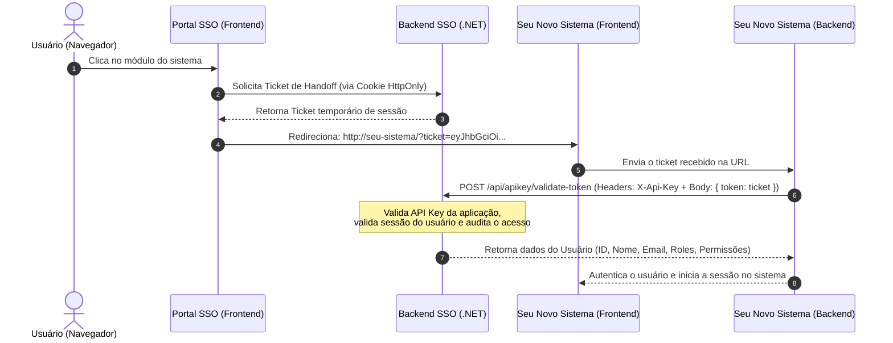

# 🔐 Guia de Integração com o SSO Portal Doce Brinquedo

Este documento contém todas as instruções técnicas, rotas, headers e exemplos práticos de código para você (ou seu Agente de IA) implementar a autenticação integrada com o SSO em qualquer novo sistema ou microsserviço.

---

## 🧭 1. Visão Geral do Fluxo de Autenticação



---

## 🔑 2. Credenciais Necessárias (API Key)

Antes de integrar, acesse o Portal SSO como Administrador:
1. Acesse: **Painel Admin > Chaves & Logs** (`/control/admin-page/apikey-page-admin`).
2. Clique em **"+ Nova Chave de API"**.
3. Informe o nome do seu sistema (ex: `Sistema de Vendas`, `Módulo Estoque`).
4. Selecione o módulo correspondente e copie a chave gerada (ex: `dc_live_7a8b9c0d1e2f3a4b...`).
5. Armazene essa chave nas variáveis de ambiente (`.env` ou `appsettings.json`) do backend do seu novo sistema.

---

## 📡 3. Endpoints Disponíveis para Integração (`/api/apikey`)

> **Base URL do SSO**: `http://<IP_DO_SSO>:7000` (ou domínio configurado)

### Endpoint 1: Validar Ticket / Token de Usuário (Recomendado)
Usado pelo backend do seu sistema logo após o usuário chegar pelo redirecionamento do portal.

- **Método**: `POST`
- **URL**: `http://<IP_DO_SSO>:7000/api/apikey/validate-token`
- **Headers**:
  - `Content-Type: application/json`
  - `X-Api-Key: dc_live_xxxxxxxxxxxxxxxxxxxxxxxx`
- **Body**:
  ```json
  {
    "token": "ticket_ou_jwt_recebido_na_url"
  }
  ```
- **Resposta de Sucesso (`200 OK`)**:
  ```json
  {
    "success": true,
    "message": "Token validado com sucesso",
    "data": {
      "id": "3fa85f64-5717-4562-b3fc-2c963f66afa6",
      "name": "Nome do Usuário",
      "email": "usuario@docebrinquedo.com.br",
      "avatar": "http://192.168.13.244:7000/uploads/profile/avatar.png",
      "departamentId": "a1b2c3d4-e5f6-7a8b-9c0d-1e2f3a4b5c6d",
      "departamentName": "Tecnologia da Informação",
      "roles": ["Admin", "Dev"],
      "permissions": ["usuarios:listar", "chamados:atender"]
    },
    "errors": null,
    "meta": null
  }
  ```
- **Respostas de Erro**:
  - `401 Unauthorized`: Chave de API inválida, token expirado ou usuário inativo.

---

### Endpoint 2: Consultar Usuário Atual (`/me`)
Usado quando você já possui o token e deseja obter os dados do usuário.

- **Método**: `GET`
- **URL**: `http://<IP_DO_SSO>:7000/api/apikey/me`
- **Headers**:
  - `X-Api-Key: dc_live_xxxxxxxxxxxxxxxxxxxxxxxx`
  - `Authorization: Bearer <token_do_usuario>`

---

### Endpoint 3: Buscar Todos os Usuários e Departamentos
Usado caso seu sistema precise sincronizar ou listar colaboradores da empresa.

- **Método**: `GET`
- **URL**: `http://<IP_DO_SSO>:7000/api/apikey/users`
- **Headers**:
  - `X-Api-Key: dc_live_xxxxxxxxxxxxxxxxxxxxxxxx`
- **Resposta de Sucesso (`200 OK`)**:
  ```json
  {
    "success": true,
    "message": "Usuários listados com sucesso",
    "data": {
      "userResponses": [
        {
          "id": "3fa85f64-5717-4562-b3fc-2c963f66afa6",
          "name": "João da Silva",
          "email": "joao@docebrinquedo.com.br",
          "avatar": "http://192.168.13.244:7000/uploads/profile/foto.jpg",
          "isActive": true,
          "departamentId": "b2c3d4e5-f6a7-8b9c-0d1e-2f3a4b5c6d7e",
          "departament": {
            "id": "b2c3d4e5-f6a7-8b9c-0d1e-2f3a4b5c6d7e",
            "name": "Financeiro"
          },
          "roles": [
            { "id": "uuid", "name": "Usuario" }
          ],
          "permissions": [
            { "id": "uuid", "name": "financeiro:visualizar" }
          ]
        }
      ]
    }
  }
  ```

---

## 💻 4. Exemplos Práticos de Implementação nos Seus Novos Sistemas

### Exemplo em Node.js / Express / TypeScript (Backend)

```typescript
import express, { Request, Response } from 'express';
import axios from 'axios';

const app = express();
app.use(express.json());

const SSO_URL = process.env.SSO_URL || 'http://192.168.13.244:7000';
const API_KEY = process.env.SSO_API_KEY || 'dc_live_sua_chave_aqui';

// Rota de login/validação do seu novo sistema
app.post('/api/auth/sso-login', async (req: Request, res: Response) => {
  const { ticket } = req.body;

  if (!ticket) {
    return res.status(400).json({ error: 'Ticket de autenticação não fornecido' });
  }

  try {
    // Valida com o SSO enviando a API Key
    const response = await axios.post(
      `${SSO_URL}/api/apikey/validate-token`,
      { token: ticket },
      {
        headers: {
          'X-Api-Key': API_KEY,
          'Content-Type': 'application/json'
        }
      }
    );

    const userData = response.data.data;

    // TODO: Aqui você cria a sessão local do seu sistema (ex: gera seu próprio JWT ou cookie)
    return res.json({
      success: true,
      user: userData
    });
  } catch (error: any) {
    const errorMsg = error.response?.data?.message || 'Falha ao validar com o SSO';
    return res.status(401).json({ error: errorMsg });
  }
});
```

---

### Exemplo em .NET (C# / Web API)

```csharp
public class SsoService
{
    private readonly HttpClient _httpClient;
    private readonly string _apiKey = "dc_live_sua_chave_aqui";
    private readonly string _ssoBaseUrl = "http://192.168.13.244:7000";

    public SsoService(HttpClient httpClient)
    {
        _httpClient = httpClient;
    }

    public async Task<UserResponseDto?> ValidateTicketAsync(string ticket)
    {
        var request = new HttpRequestMessage(HttpMethod.Post, $"{_ssoBaseUrl}/api/apikey/validate-token")
        {
            Content = JsonContent.Create(new { token = ticket })
        };
        request.Headers.Add("X-Api-Key", _apiKey);

        var response = await _httpClient.SendAsync(request);
        if (!response.IsSuccessStatusCode)
        {
            return null;
        }

        var result = await response.Content.ReadFromJsonAsync<ApiResponse<UserResponseDto>>();
        return result?.Data;
    }
}
```

---

### Exemplo em Frontend (React / Angular / Vue)

```typescript
// Quando o usuário abre o sistema através da URL com ?ticket=... ou ?token=...
const queryParams = new URLSearchParams(window.location.search);
const ticket = queryParams.get('ticket') || queryParams.get('token');

if (ticket) {
  // Limpa o ticket da barra de endereços para não poluir a URL
  window.history.replaceState({}, document.title, window.location.pathname);

  // Envia o ticket para o backend do seu sistema autenticar
  fetch('/api/auth/sso-login', {
    method: 'POST',
    headers: { 'Content-Type': 'application/json' },
    body: JSON.stringify({ ticket })
  })
  .then(res => res.json())
  .then(data => {
    if (data.success) {
      console.log('Logado com sucesso:', data.user);
      // Redireciona para o dashboard do seu sistema
    }
  });
}
```

---

## 🛡️ 5. Boas Práticas de Segurança

1. **Nunca exponha a `X-Api-Key` no Frontend**: A chamada para `/api/apikey/validate-token` deve ser feita sempre pelo **backend** do seu sistema.
2. **Remova o parâmetro da URL logo após a leitura**: Utilize `window.history.replaceState()` no frontend logo após capturar o `ticket` da URL.
3. **Auditoria em tempo real**: Qualquer requisição rejeitada por chave incorreta ou token expirado ficará visível na aba **Logs de Auditoria** do Portal SSO.
